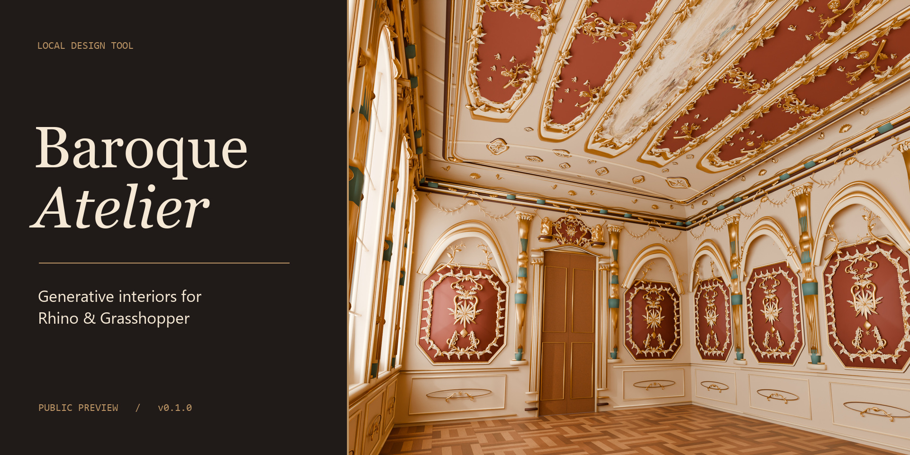
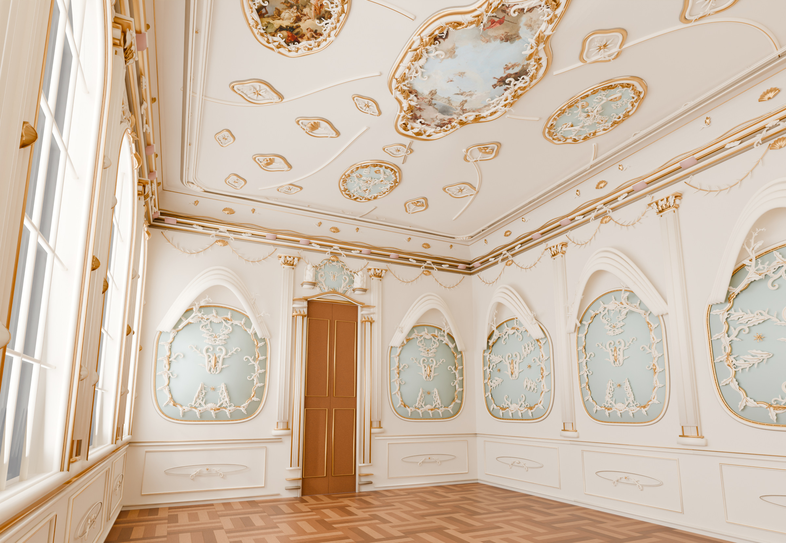
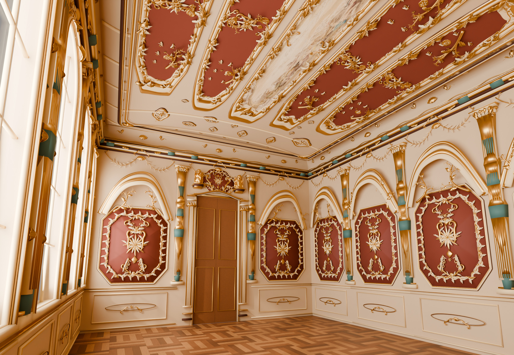

# Baroque Atelier

**Baroque Atelier is a local design tool for exploring baroque interiors inside a fixed room envelope.** Generate a hall with a blank brief or describe a direction, then tune the relief, branching, and room dimensions in Grasshopper. The desktop edition exports editable OBJ meshes, materials, and a JSON recipe.

[Русская инструкция](docs/README.ru.md) · [Showcase and project files](docs/SHOWCASE.md) · [Artwork and dependencies](docs/ATTRIBUTION.md)

## Try the preview

1. Download **baroque-atelier-v0.1.0-windows.zip** from the [v0.1.0 release](https://github.com/goykalov/baroque-atelier/releases/tag/v0.1.0) and extract it.
2. Launch **atelier/Start Atelier.cmd** for the standalone Windows interface. It uses Python 3.9+ with Tcl/Tk. For Rhino 9, open **atelier/Atelier.gh** in Grasshopper.
3. Select a search budget and click **Найти новый зал**. A blank brief is enough. The interface currently uses Russian.

The Windows archive includes llama.cpp. For offline Qwen search, place **Qwen3 8B GGUF** at **atelier/models/qwen3-8b.gguf** or set **BAROQUE_MODEL_PATH**. The tool can also find an existing Ollama **qwen3:8b** weight file and open it directly in llama.cpp. The standalone **Автономные правила** mode works without model weights. [Qwen3 8B GGUF](https://huggingface.co/Qwen/Qwen3-8B-GGUF)

## What you can control

- Room length, width, and height, or a rectangular closed room volume in Grasshopper.
- A new combination of wall structure, ceiling volume, and field layout at each search. The search compares recent layouts to favor different geometry.
- Recursive acanthus relief, ornament depth, foliage, gilding, and museum paintings placed as ceiling textures.
- Search budgets of up to **1 minute, 10 minutes, or 1 hour**. The offline model proposes and revises structured plans. Meshing and export follow the search.

## Two fresh examples

| Hall 01 | Hall 02 |
| --- | --- |
|  |  |
| [Ceiling view](docs/showcase/hall-01-ceiling.jpg) · [Recipe](examples/hall-01.recipe.json) | [Ceiling view](docs/showcase/hall-02-ceiling.jpg) · [Recipe](examples/hall-02.recipe.json) |

These are Blender Cycles renders of meshes from the generator. Both halls were produced with blank briefs at the same **12 × 8.5 × 6.8 m** dimensions. The [showcase log](examples/showcase.json) records the generated architecture, seed, search passes, and original OBJ hash.

## Project status

This is a Windows and Rhino 9 design preview. The output is polygonal concept geometry. Full-hour search has not been validated end to end. Detailed exports can be large. The original project code currently has no open-source license specified. The museum assets and third-party runtime have separate terms. [Attribution](docs/ATTRIBUTION.md)
