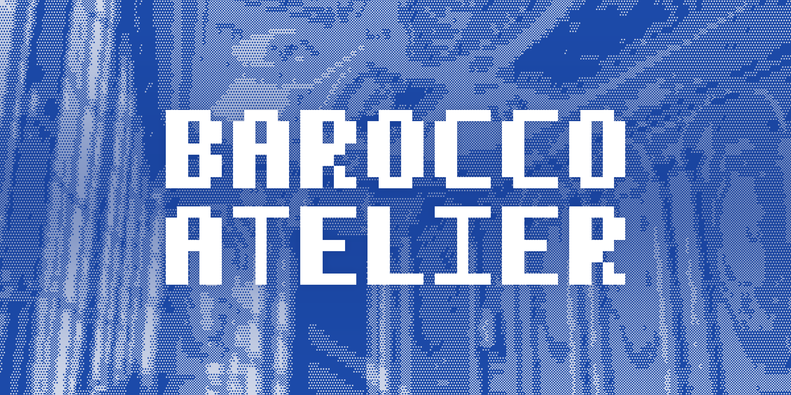
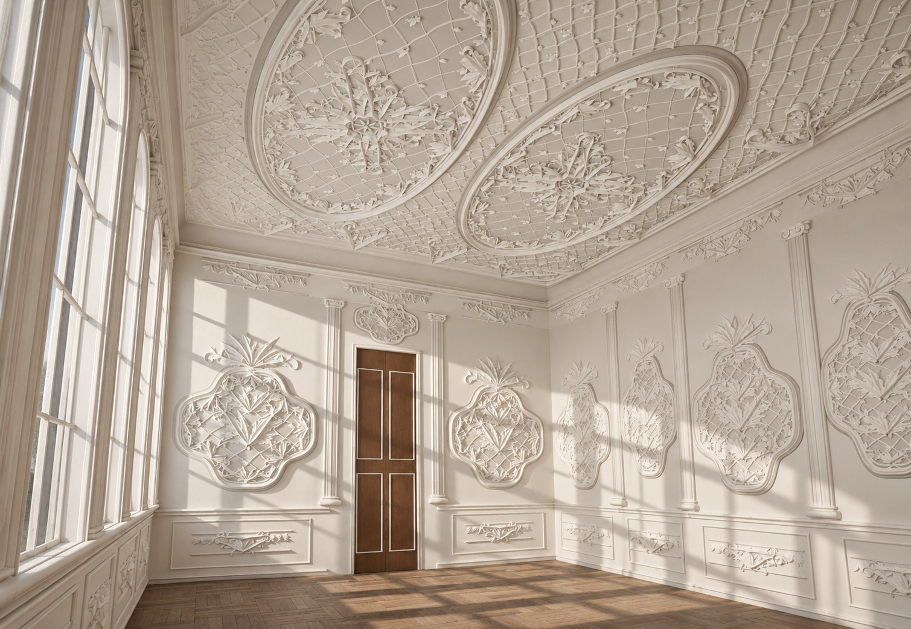
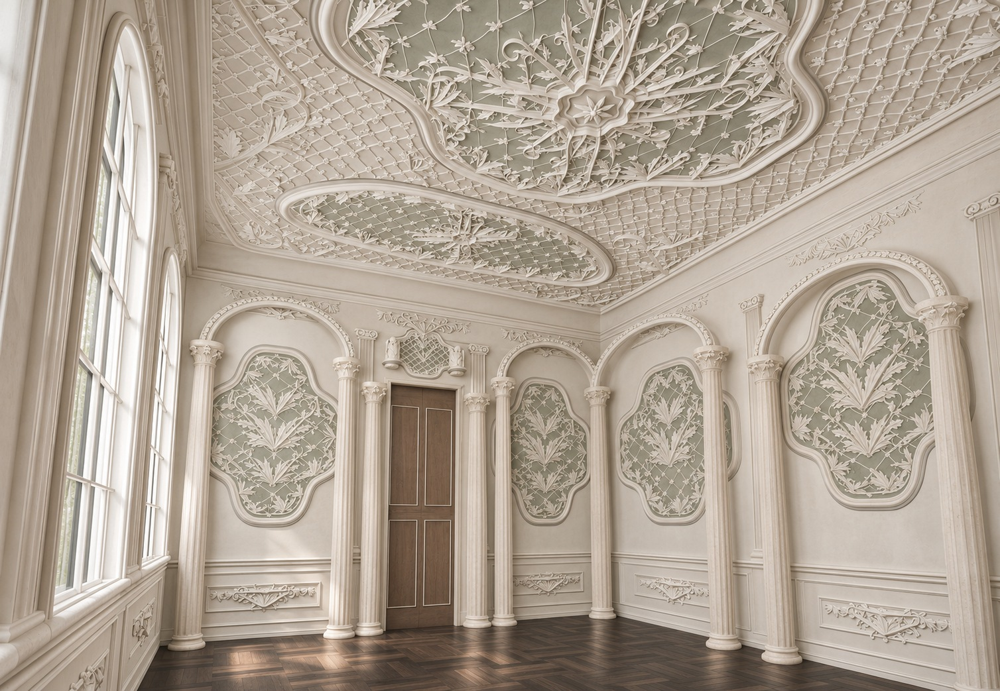

# Barocco Atelier

**Generate and edit Baroque interiors inside a room you define.** Start with dimensions and a brief, compare compositions, then tune branching plasterwork and relief in Rhino and Grasshopper. The standalone Windows app exports editable OBJ meshes, materials, and a JSON recipe you can reopen.

[Русская инструкция](docs/README.ru.md) · [Gallery](docs/SHOWCASE.md) · [Roadmap](ROADMAP.md) · [Wiki](https://github.com/goykalov/baroque-atelier/wiki) · [Discussions](https://github.com/goykalov/baroque-atelier/discussions) · [Issues](https://github.com/goykalov/baroque-atelier/issues)

## Quickstart

1. [Download the current project as a ZIP](https://github.com/goykalov/baroque-atelier/archive/refs/heads/main.zip) and extract it.
2. In Rhino 9, open [Atelier-Carved.gh](atelier/Atelier-Carved.gh) in Grasshopper. For the standalone Windows interface, launch **atelier/Start Atelier.cmd** with Python 3.9+ and Tcl/Tk installed.
3. Select **Автономные правила** (local rules), choose a search preset and click **Найти новый зал** (find a new hall). A blank brief is enough. The interface uses Russian.

For offline Qwen search, copy the **atelier/engine** folder from the [v0.3.0 Windows release](https://github.com/goykalov/baroque-atelier/releases/tag/v0.3.0) into the current project or point **BAROQUE_LLAMA_BIN** to a local **llama-completion.exe**. Put [Qwen3 8B GGUF](https://huggingface.co/Qwen/Qwen3-8B-GGUF) at **atelier/models/qwen3-8b.gguf** or set **BAROQUE_MODEL_PATH**. The tool can also open existing Ollama **qwen3:8b** weights directly in llama.cpp. Then select **Qwen без сети** (offline Qwen).

## Design workflow

| Step | What you can do |
| --- | --- |
| Generate a composition | Set length, width, and height or supply a closed rectangular volume in Grasshopper. Choose a quick search, staged refinement, or an experimental vault search. |
| Shape the ornament | Adjust relief height, foliage density, and branching. In **Резной зал** (carved hall), **Влияние формулы, %** sets how strongly recursive branches and interlacing shape the relief. Carving grows from the panels, frieze, and ceiling frames. |
| Revise a zone | Rewrite the ceiling or the relief above the door with a text request. Matching objects in neighbouring zones retain their geometry and, in Rhino, their object IDs. |
| Save or rebuild | Keep the generated recipe with the OBJ and materials. Open the recipe in the desktop app to rebuild the hall. |

Use **Сохранить найденное** to finish a search with its best result so far. Experimental vault-search presets allow 5 or 60 minutes for comparing candidates. Preparation and export take additional time. The exporter keeps a recoverable `.checkpoint.json` while a job runs. [Windows and Rhino instructions](docs/README.ru.md)

## Gallery

Three carved halls share a **12 × 8.5 × 6.8 m** envelope. Blender Cycles renders of the generated geometry were used as the source for lighting and material finishing in ImageGen. [All ten views and generation recipes](docs/SHOWCASE.md)

| White plaster | Muted sage |
| --- | --- |
|  |  |

## Development and feedback

The next preview focuses on a reproducible setup, a lighter Grasshopper preview, and comparisons that show what changes with longer searches and different room compositions.

- Follow the work in the [roadmap](ROADMAP.md) and the [next-preview milestone](https://github.com/goykalov/baroque-atelier/milestone/1).
- Share a generated hall, ask a question, or propose a direction in [Discussions](https://github.com/goykalov/baroque-atelier/discussions).
- Use [Issues](https://github.com/goykalov/baroque-atelier/issues) for reproducible problems and defined improvements. [Contributing guide](CONTRIBUTING.md)

## Project status

This is a Windows and Rhino 9 design preview. It exports polygonal concept geometry. The main carved hall has about 10.7 million triangles at its gallery settings. The project code currently has no open-source license specified. The museum assets and third-party runtime have separate terms. [Artwork and dependency credits](docs/ATTRIBUTION.md)
