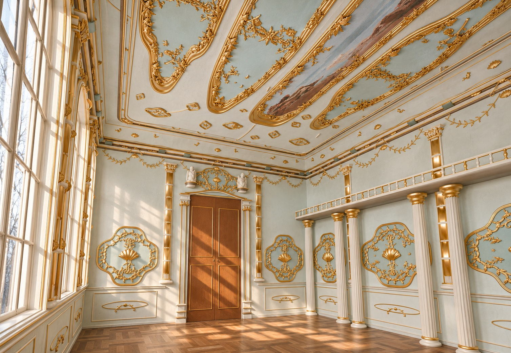
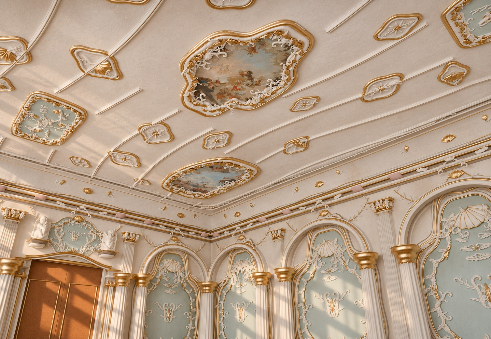
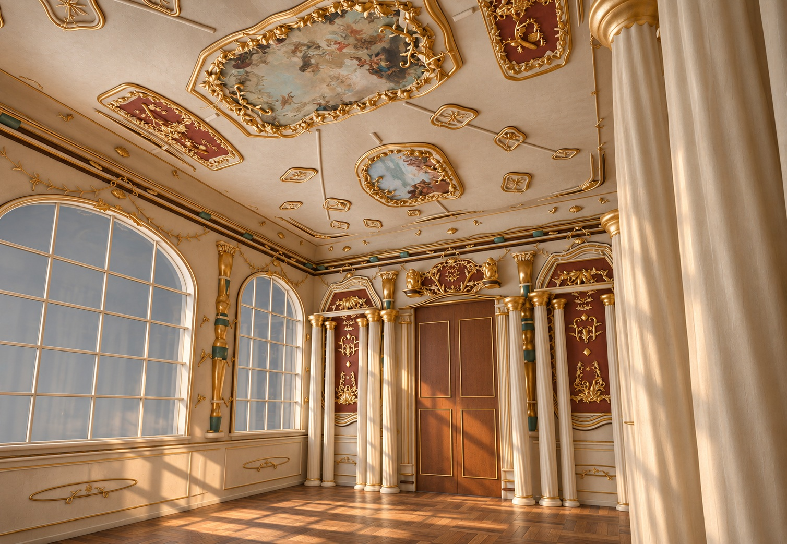
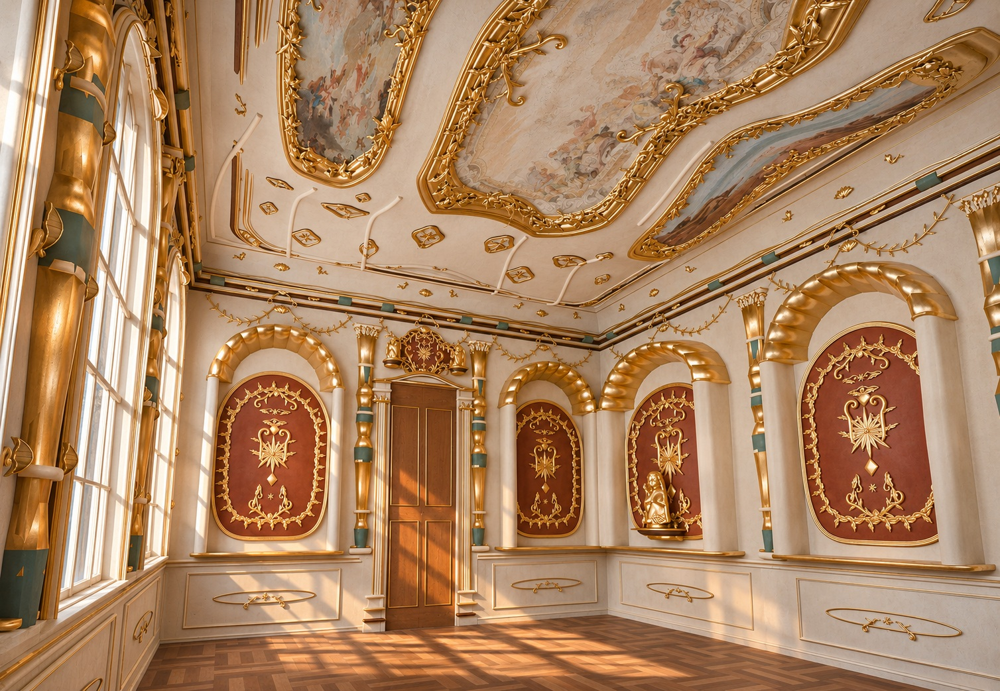
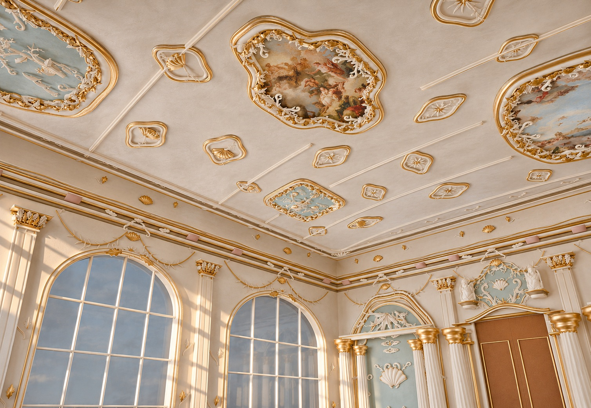
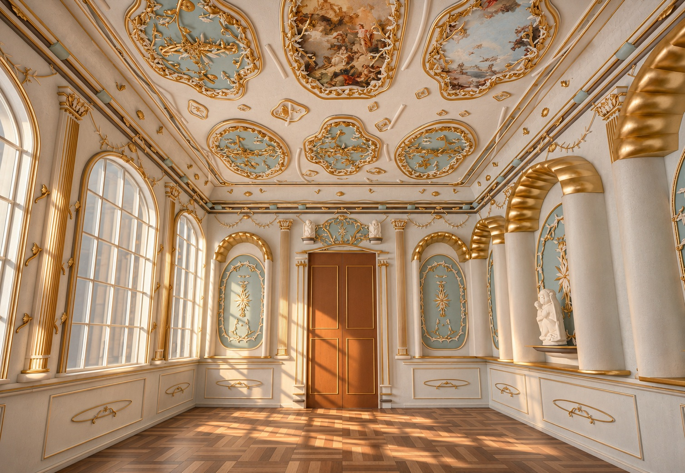
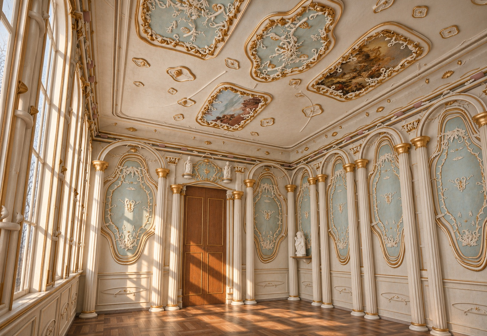
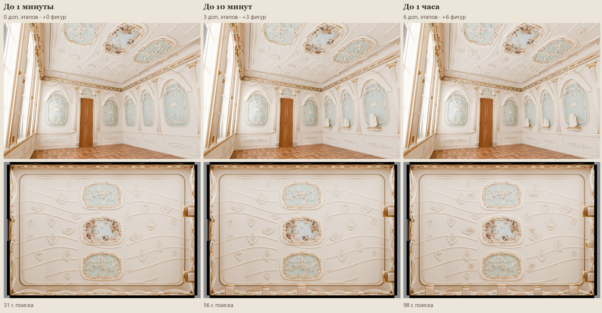

# Six baroque halls

Six local searches used the same **12 × 8.5 × 6.8 m** room envelope. The gallery compares different wall structures and ceiling compositions. Each image starts from the exported 3D geometry rendered in Blender Cycles, then uses the same ImageGen finishing direction for window light, mineral plaster, aged gilding and wood grain.

## 01 · Upper gallery and radial tracery

[Editable generation recipe](../examples/gallery/hall-03.recipe.json)

## 02 · Arcades and interlaced vault

[Editable generation recipe](../examples/gallery/hall-04.recipe.json)

## 03 · Paired columns and scalloped relief

[Editable generation recipe](../examples/gallery/hall-05.recipe.json)

## 04 · Exedras and deep coffers

[Editable generation recipe](../examples/gallery/hall-06.recipe.json)

## 05 · Paired columns and ribbed vault

[Editable generation recipe](../examples/gallery/hall-07.recipe.json)

## 06 · Exedras and garlands

[Editable generation recipe](../examples/gallery/hall-08.recipe.json)

The [generation log](../examples/gallery/gallery.json) records the briefs, selected wall and ceiling structures, seeds, search passes, and original OBJ hashes. The two original preview scenes are available as OBJ downloads in the [v0.1.0 release](https://github.com/goykalov/baroque-atelier/releases/tag/v0.1.0).

## v0.2.0 · Ceiling revision

A local search with the 10-minute preset finished in 3 minutes 17 seconds. It compared 95 valid recipes and accepted 15 Qwen proposals. A second search rebuilt the ceiling with a central relief and open corners inside the same hall. Window light and material textures were finished in ImageGen over the Blender render.

[Starting hall recipe](../examples/v0.2.0/before.recipe.json) · [Ceiling revision recipe](../examples/v0.2.0/after.recipe.json)

## v0.3.0 · One hall across three budgets

The three presets share the same composition and room dimensions. The medium preset adds three refinement stages. The hour preset adds six, including a second series of frames, friezes and sculpture groups. These are matched Blender views of the exported geometry.

[Generation comparison](../examples/v0.3.0/comparison.json) · [Fast recipe](../examples/v0.3.0/fast.recipe.json) · [Medium recipe](../examples/v0.3.0/medium.recipe.json) · [Hour recipe](../examples/v0.3.0/hour.recipe.json)
