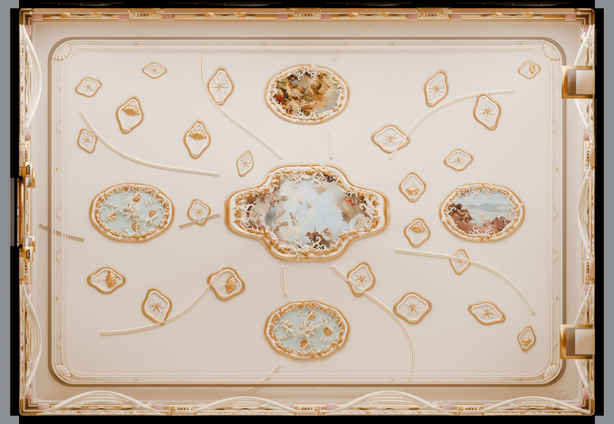
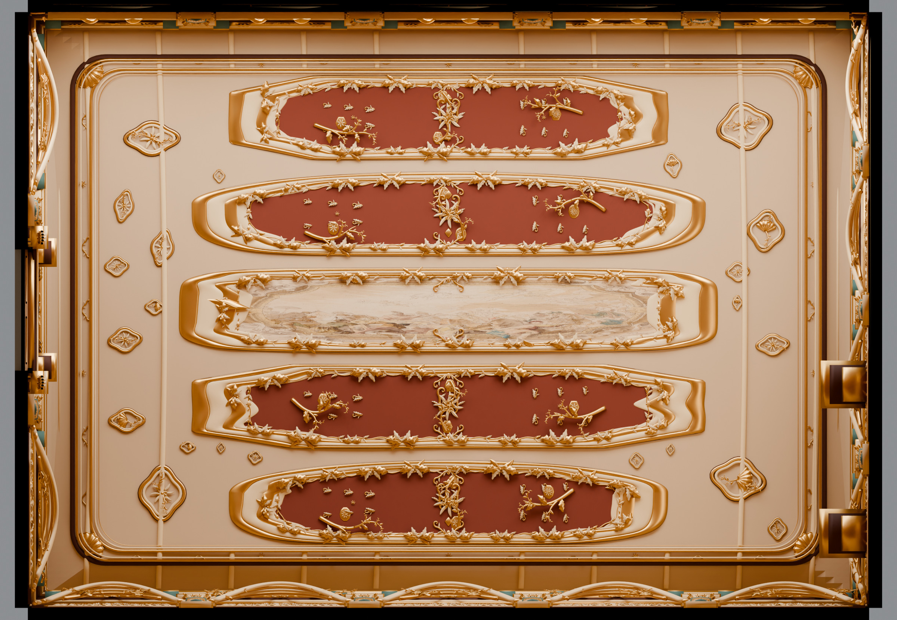

# Two searches, one room envelope

Two consecutive blank-brief searches generated these halls entirely on the local machine. Each uses a **12 × 8.5 × 6.8 m** envelope. The renderer imported the exported meshes, then applied editorial lighting, physically based materials, and cameras in Blender Cycles. The OBJ geometry is the same geometry used in the images.

## Hall 01

[Rebuild this hall from its recipe](../examples/hall-01.recipe.json)

## Hall 02

[Rebuild this hall from its recipe](../examples/hall-02.recipe.json)

Both editable OBJ scenes, with materials and image textures, are included in **baroque-atelier-v0.1.0-sample-scenes.zip** on the [release page](https://github.com/goykalov/baroque-atelier/releases/tag/v0.1.0). [Generation log](../examples/showcase.json)
